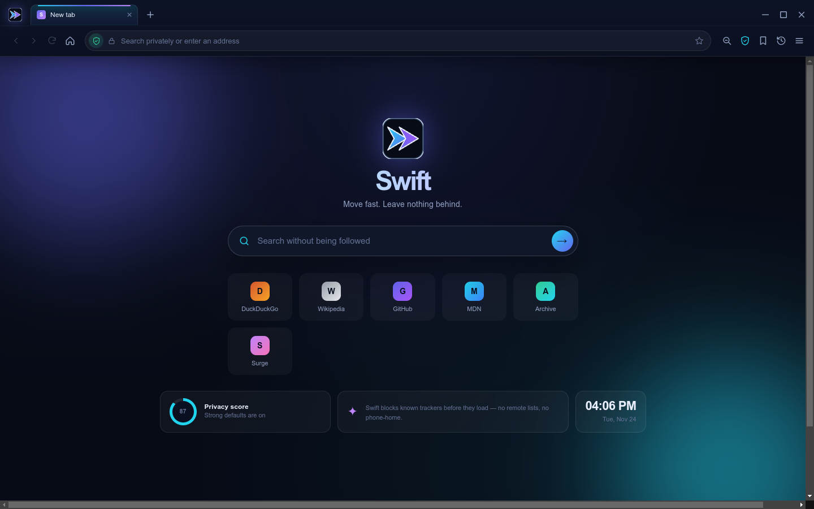
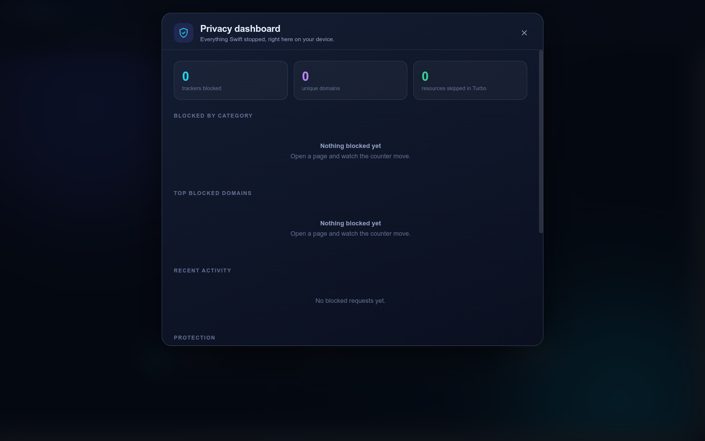

<h1 align="center"></h1>

<p align="center"><strong>The browser that moves at your speed.</strong><br>Swift is a fast, privacy-first desktop browser built with Electron and Chromium, with a local-first app suite behind one device-local Swift ID. No cloud account, no telemetry, no remote blocklist download.</p>





## What makes Swift different

**Privacy by default**

- A bundled third-party tracker list (ads, analytics, social widgets, fingerprinting, pixels, malvertising). It ships inside the app, so there is no update server to phone home to. Only cross-origin requests are blocked, which keeps sites that self-host assets working.
- Fingerprint defenses: consistent `navigator` and `screen` values, masked WebGL renderer strings, and an optional `strict` mode with canvas and timer noise. Sites in the allowlist keep their original behavior.
- HTTPS upgrading for plain HTTP addresses, with automatic failure fallback so a site that cannot do HTTPS still loads.
- Global Privacy Control (`Sec-GPC`) and `DNT` headers, strict referrer trimming, and third-party cookies off by default.
- Permission denials for geolocation, notifications, camera and microphone unless you explicitly allow them.
- Private tabs use a memory-only session partition that vanishes when Swift closes.

**Speed you can feel**

- Tracker requests are cancelled before they reach the network, so pages load less junk.
- **Turbo mode** skips third-party images and media on metered connections.
- **Tab sleeping** releases background tab memory after a configurable idle time and reloads the tab when you return.
- The new tab page is entirely local — no remote start page, no search suggestions sent anywhere.

**Your data stays yours**

- History, bookmarks, settings and privacy counters live in a local JSON file under Electron's `userData` directory.
- A privacy dashboard shows what was blocked, by which domain and category, with one-click reset.
- Export your data as JSON from Settings. Clear site data and history locally.

## Swift apps and Swift ID

Every app opens as a `swift://<app>` page from the sidebar rail, the new-tab grid, the command palette (`Ctrl+K`) or the address bar (`@chat`, `swift:docs`, `swift://drive`).

| App | What it does |
| --- | --- |
| Swift ID | Device-local PBKDF2 account with custom signup/signin screens and single sign-on for the suite |
| Swift Chat | Topic threads with actions that flow into Tasks |
| Swift Meet | Browser-native WebRTC rooms with local meeting summaries |
| Swift AI | One local search across docs, notes, chats, calendar, tasks, sheets and encrypted Drive filenames |
| Swift Docs | Block editor with Markdown export |
| Swift Sheets | Local grid with formulas and JSON data connectors |
| Swift Decks | Plain-text outlines into presentations |
| Swift Notes | Quick notes, links and locally stored voice memos |
| Swift Calendar | Events, focus blocks and a personal booking link |
| Swift Drive | AES-256-GCM encrypted files with plain-English filename search |
| Swift Tasks | One list fed by Chat, Docs and Meet action items |
| Swift Mail | **Coming soon** — a custom domain is needed before `@swift.email` addresses exist |

Swift ID credentials never leave the device. The Drive key is derived at sign-in and exists only in memory, so Swift asks you to sign in again after a restart before encrypted files can be decrypted. Nothing is sent to an identity server, AI model or sync backend.

## Editions

Swift ships as five official channels from the same codebase: **Swift Lite** (low-resource), **Swift Enterprise** (policy-managed), **Swift Beta** (public preview), **Swift Nightly / Canary** (bleeding edge) and **Swift Developer** (automation and DevTools). Each has its own profile, icon, defaults and release artifacts. See [EDITIONS.md](EDITIONS.md) for selectors, policies and build commands.

## Run it

```bash
cd swift-browser
npm install
npm start
```

Minimum keyboard shortcuts: `Ctrl+T` new tab, `Ctrl+W` close tab, `Ctrl+L` address bar, `Ctrl+R` reload, `Ctrl+P` privacy dashboard, `Ctrl+K` command palette, `Ctrl+F` find in page, `Ctrl+Shift+N` private tab, `F11` fullscreen.

## Build a release

The host architecture is `arm64` on Raspberry Pi 5 and `x64` on most desktops.

```bash
npm run dist:linux-arm64   # dist/swift-browser-linux-arm64.tar.gz
npm run dist:linux-x64     # dist/swift-browser-linux-x64.tar.gz
npm run check              # syntax checks for every JS file
```

`electron-builder.yml` also has macOS and Windows targets; use `npx electron-builder --mac --arm64` and `npx electron-builder --win --x64` on the appropriate host.

## Snap

`snapcraft.yaml` builds a strict `swift-browser` snap from the locally built tarball.

```bash
# Build locally (requires snapcraft)
npm run dist:linux-arm64
snapcraft --destructive-mode          # or simply: npx electron-builder --linux --arm64 -c electron-builder.snap.yml
sudo snap install ./swift-browser_1.0.0_arm64.snap --dangerous

# Publish to the Snap Store (requires a logged-in publisher account)
snapcraft login
snapcraft upload --release=stable ./swift-browser_1.0.0_arm64.snap
snapcraft upload --release=stable ./swift-browser_1.0.0_amd64.snap
```

The snap plugs `network`, `network-bind`, `home`, `removable-media`, `desktop`, `desktop-legacy`, `opengl`, `wayland`, `x11`, `pulseaudio` and `browser-support`.

## Flatpak / Flathub

`flatpak/com.swiftbrowser.Swift.yml` is a single-arch-aware manifest for `com.swiftbrowser.Swift`.

```bash
# Build a single-file bundle locally
flatpak-builder --user --install --force-clean build-dir \
  flatpak/com.swiftbrowser.Swift.yml
flatpak-builder --repo=repo --force-clean build-dir \
  flatpak/com.swiftbrowser.Swift.yml
flatpak build-bundle repo swift-browser.flatpak com.swiftbrowser.Swift stable
flatpak install --user swift-browser.flatpak
flatpak run com.swiftbrowser.Swift
```

Before building, replace `SHA256_X64` and `SHA256_ARM64` in the manifest with the real hashes of the release tarballs:

```bash
sha256sum dist/swift-browser-linux-x64.tar.gz
sha256sum dist/swift-browser-linux-arm64.tar.gz
# or: bash scripts/update-flatpak-sha.sh
```

### Submitting to Flathub

Flathub publishes from reviewable GitHub pull requests; a local build cannot be pushed without a GitHub account that has permission on the Flathub repository.

1. Create the public release `v1.0.0` on `github.com/404henryyynotfound/swift-browser` and attach both `swift-browser-linux-x64.tar.gz` and `swift-browser-linux-arm64.tar.gz` plus `.sha256` files.
2. Fill in the real SHA256 values in `flatpak/com.swiftbrowser.Swift.yml`.
3. Fork `github.com/flathub/flathub`, then add the contents of `swift-browser/flatpak/` under a new top-level directory `com.swiftbrowser.Swift/`.
4. Open a PR with the manifest, desktop file, metainfo and icons. Add at least one screenshot hosted in the PR repository.
5. Address review feedback; Flathub will build and publish after approval.

Install command once approved:

```bash
flatpak install flathub com.swiftbrowser.Swift
```

## Landing page

The site in `site/` is dependency-free static HTML/CSS/JS with a raw WebGL flow-field shader, scroll reveals and animated counters. Preview locally and deploy:

```bash
cd site
python3 -m http.server 8080
cd ..
npx surge ./site swift-browser.surge.sh
```

Surge needs to be logged in (`npx surge login`) with an account that controls the domain. See `site/README.md` for details.

## Project layout

```
main.js                 main process: tabs, sessions, privacy filters, IPC, swift:// protocol
preload.js              per-page fingerprint defenses
apps-preload.js         narrow bridge for local Swift apps
ui-preload.js           narrow bridge for the trusted chrome UI
privacy/blocklist.js    bundled tracker list and classification
lib/store.js            atomic local JSON store
lib/swift-apps.js       Swift ID, app data, Drive encryption, AI search, IPC handlers
lib/editions.js         edition registry, selectors and feature flags
ui/                     browser chrome, new tab page, dashboards
ui/apps/                shared shell and runtime for all twelve apps
assets/                 logo and PNG icons
snap/                   Snap wrappers and desktop file
flatpak/                Flathub manifest, metainfo, desktop file, icons
site/                   landing page for swift-browser.surge.sh
```

## Honest scope

Swift is a browser built on Chromium via Electron, not a new rendering engine from scratch. Building an engine comparable to Chromium or Gecko is a multi-year effort; this project focuses on the parts a browser maker can actually own — the interface, the privacy policy enforced in code, the tab model and the packaging. It is Linux-first (arm64 and x64), with macOS and Windows build targets available.
